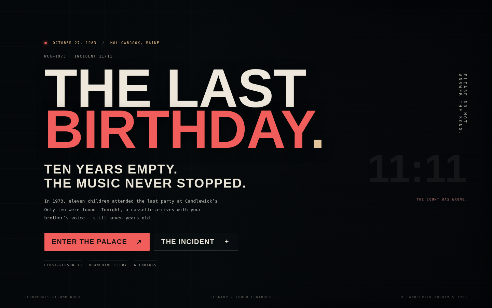

# THE LAST BIRTHDAY 🎈
### A first-person 3D interactive horror story · October 27, 1983

**Status:** Playable, complete single-session browser game with first-person 3D exploration, chase/hiding, evidence collection, branching conversations, and **six ending outcomes**. Built for GitHub Pages using HTML, CSS, and plain JavaScript + pinned Three.js. **No build step, installation, login, or external image assets.**

> TEN YEARS EMPTY. THE MUSIC NEVER STOPPED.

## 🎮 Play

On **desktop**: click **ENTER THE PALACE** and pick your first story choice. The game captures your mouse after you close a dialogue. If the mouse is released, click the game window or resume from pause.

| Control | Keyboard / mouse | Mobile / touch |
| --- | --- | --- |
| Walk | W A S D / arrows | Left joystick |
| Look | Move mouse | Drag on right side of view |
| Interact / choose | E / click choice button | USE button / tap choices |
| Sprint | Hold Shift | Hold RUN |
| Flashlight | F | LIGHT |
| Pause / resume | Esc / top-right button | Top-right pause button |
| Journal | J | NOTES button |
| Map | M | MAP button |

**Flashlight:** the battery recharges slowly while turned off. **Stealth:** when the power is restored, Mr. Morrow hunts you. The prize locker in the arcade hides you for a few seconds. You can outrun him briefly, but three catches end your run. Your earlier dialogue choices change his detection range/speed.

## 🚀 Put it on GitHub Pages

1. Create a new **public** GitHub repository (for example `the-last-birthday`).
2. Upload **`index.html`**, **`style.css`**, **`script.js`** into the **root** of the repository. You may also upload `README.md` and `STORY_BIBLE.md`.
3. Open the repository's **Settings → Pages**.
4. Under **Build and deployment**, select **Deploy from a branch**, choose `main` and `/ (root)`, and save.
5. Open the URL GitHub Pages shows for your site. The game starts on the title screen.

It also works from local web servers (`python -m http.server 8000`, then open `http://localhost:8000`). **Do not double-click `index.html` from your file manager**: ES modules can be blocked by the browser's local-file security policy. Online access is needed for the Three.js import and (optionally) Google Fonts; there are no asset-pack downloads.

## 🧭 How to complete one run

1. Inspect the lobby; read the invitation (optional).
2. Find **Cassette 01** in **Party Room**, **Cassette 02** in **Game Arcade**, and **the ledger/brass key** in the **Manager’s Office**.
3. In **Maintenance**, take the **ceramic fuse** and use it at the **generator**. This wakes Mr. Morrow.
4. Open the **Backstage Door** at the end of the central hall. The key, both cassettes, and power are required.
5. Reach the **stage microphone** and make the final choice. Or return to the front doors to leave earlier. Another ending occurs if Mr. Morrow catches you three times.

All six endings appear in the ending archive as you discover them. Progress within a run resets on replay; the ending collection persists in `localStorage` in the same browser.

## 🏚️ Room directory

`LOBBY → PARTY ROOM / GAME ARCADE → MANAGER’S OFFICE / MAINTENANCE → BACK HALL → BIRTHDAY STAGE`

## 🔧 Files

- `index.html` — all game menus, HUD, dialogue, endings, touch controls, accessibility labels.
- `style.css` — responsive cinematic UI, VHS/grain/lighting effects, mobile controls.
- `script.js` — 3D level, props, ambient lighting, player/camera, collision, interaction, audio, puzzles, enemy AI, ending logic.
- `STORY_BIBLE.md` — narrative treatment, characters, mystery, locations, chapter structure, mechanics, and outcomes.

## ⚙️ Technical notes

- Three.js is **pinned to v0.160.0** from jsDelivr, rather than depending on an unstable `latest` tag.
- All visible rooms, furniture, mascot, signs, balloons, arcade cabinets, posters, dust particles, and pickups are **procedurally modeled** at runtime; textures and signage are drawn into CanvasTextures. Sounds are generated with the **Web Audio API** after you start the game.
- Game runs entirely in the browser; no server APIs, tracking, saved personal information, login, or hidden backend.
- Visual fidelity varies with the device's GPU. To improve performance on slower phones, decrease `renderer.setPixelRatio` in `script.js` (for example, cap it to `1.1`) and disable shadow maps.

### Scope / future expansion

This is a playable **3D indie-game prototype**, not a full multi-gigabyte AAA commercial release. For a larger production: replace procedural geometry with detailed GLB environments and character animation, implement navigation mesh/pathfinding and multiple levels, add recorded voice acting and positional audio, checkpoint saves, gamepad access, and rigorous device QA.

---

*Fictional setting and characters. October 27, 1983. Candlewick's has no exit sign for the party room.*
